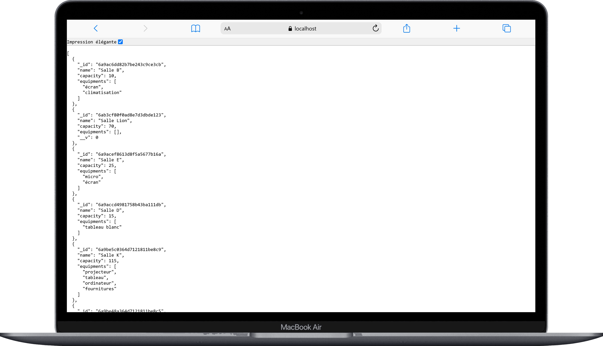

# la-bonne-salle-au-bon-moment-docker-cda

Orchestration Docker (frontend + backend + MongoDB) pour le projet "La Bonne Salle au Bon Moment".

---

## Aperçu

| Frontend | Backend (API) |
|---|---|
|  |  |

---

## Prérequis

- Docker et Docker Compose installés
- Git

## Installation

Cloner les 3 repos dans le même dossier parent :

```bash
git clone git@github.com:fannysaez/la-bonne-salle-au-bon-moment-docker-cda.git
cd la-bonne-salle-au-bon-moment-docker-cda
git clone git@github.com:fannysaez/la-bonne-salle-au-bon-moment-frontend-cda.git
git clone git@github.com:fannysaez/la-bonne-salle-au-bon-moment-backend-cda.git
```

Créer le fichier `.env` dans `la-bonne-salle-au-bon-moment-backend-cda/` :

```bash
PORT=3000
MONGO_URI=mongodb://mongo:27017/la-bonne-salle-au-bon-moment
JWT_SECRET=<ta_valeur_secrete>
```

## Lancer le projet

```bash
docker compose up
```

- Frontend : http://localhost:5173
- Backend : http://localhost:3000 (API préfixée en `/api`, ex: `/api/users`)
- Documentation API : http://localhost:3000/api-docs

---

## ⚠️ Note pour cloner sur une autre machine

Le `docker-compose.yml` référence un volume MongoDB externe (`docker-react_mongo_data`), propre à la machine de développement d'origine. Si tu clones ce projet ailleurs, ce volume n'existera pas et `docker compose up` échouera.

Pour le faire fonctionner ailleurs, dans `docker-compose.yml`, remplace :
```yaml
volumes:
  mongo_data:
    external: true
    name: docker-react_mongo_data
```
par simplement :
```yaml
volumes:
  mongo_data:
```

Docker créera alors un nouveau volume vide automatiquement. La base MongoDB démarrera sans données (aucune collection), sauf si tu importes toi-même un export JSON avec `mongoimport`.

---

## Migration de données existantes (MongoDB Compass → Docker)

Si tu as déjà une base MongoDB locale (hors Docker) que tu veux récupérer dans le conteneur, voici la méthode utilisée pour ce projet.

### 1. Installer les outils MongoDB (WSL Ubuntu)

Ces outils (`mongodump`, `mongoimport`...) ne sont pas installés par défaut — il faut ajouter le dépôt officiel MongoDB à Ubuntu avant de pouvoir les installer.

```bash
# installe les outils nécessaires pour ajouter un dépôt sécurisé (clé GPG)
sudo apt-get install -y gnupg curl

# télécharge la clé de signature officielle de MongoDB et la stocke localement
# (cette clé permet à Ubuntu de vérifier que les paquets téléchargés viennent bien de MongoDB)
curl -fsSL https://pgp.mongodb.com/server-8.0.asc | \
  sudo gpg -o /usr/share/keyrings/mongodb-server-8.0.gpg --dearmor

# ajoute le dépôt MongoDB 8.0 à la liste des sources de paquets d'Ubuntu,
# en indiquant d'utiliser la clé téléchargée juste au-dessus pour la vérification
echo "deb [ arch=amd64,arm64 signed-by=/usr/share/keyrings/mongodb-server-8.0.gpg ] https://repo.mongodb.org/apt/ubuntu noble/mongodb-org/8.0 multiverse" | \
  sudo tee /etc/apt/sources.list.d/mongodb-org-8.0.list

# met à jour la liste des paquets disponibles (prend en compte le nouveau dépôt)
sudo apt-get update

# installe les outils en ligne de commande MongoDB (mongodump, mongoimport, etc.)
sudo apt-get install -y mongodb-database-tools
```

### 2. Exporter les collections avec MongoDB Compass

Compass est l'interface graphique de MongoDB — elle permet d'exporter une collection sans taper de commande.

Pour chaque collection : clic sur la collection → **Export Collection** → **Export the full collection** → format **JSON** → enregistrer sur le disque.

### 3. Démarrer uniquement MongoDB dans Docker

On ne démarre que le service `mongo` (pas frontend/backend), pour pouvoir y importer les données avant de lancer le reste.

```bash
docker compose up -d mongo
```

### 4. Importer les données

`mongoimport` se connecte à la base MongoDB et y insère le contenu d'un fichier JSON, collection par collection.

```bash
mongoimport --uri="mongodb://localhost:27017/la-bonne-salle-au-bon-moment" \
  --collection=NOM_DE_LA_COLLECTION \
  --file="/chemin/vers/export.json" \
  --jsonArray

# repeter pour chaque collection (reservations, roles, rooms, users...)
```

### 5. Lancer le projet complet

Une fois les données importées, on peut démarrer tous les services (frontend + backend + mongo).

```bash
docker compose up
```

---

## Arrêter le projet

Pause rapide (conteneurs gardés, redémarrage instantané) :
```bash
docker compose stop
```

Arrêt complet (conteneurs supprimés, données conservées) :
```bash
docker compose down
```

---

Les données MongoDB sont conservées dans le volume `docker-react_mongo_data`.